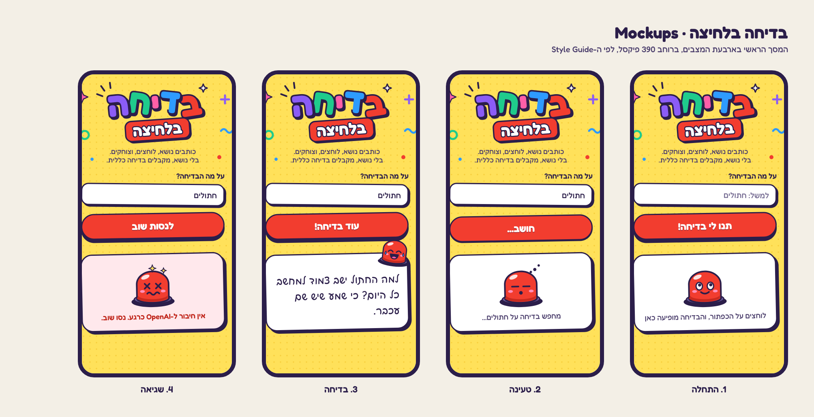
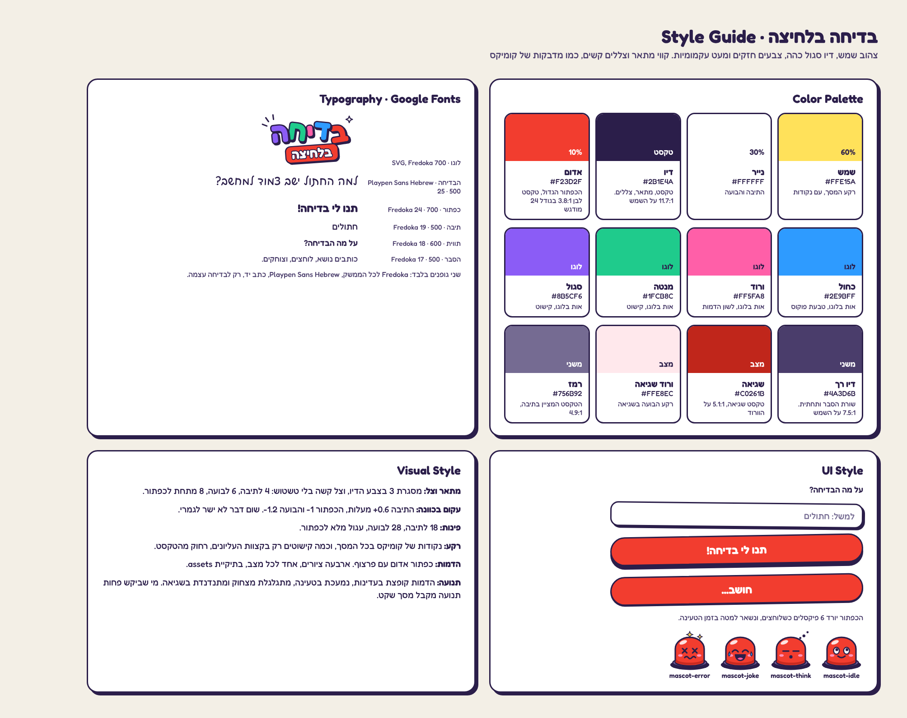

# DESIGN: הבדיחות של דובב

עודכן ב-28.10.2026: השם הוחלף ל"הבדיחות של דובב", נוסף מצב טריוויה, הדמות היא התמונה של דובב, והרקע הוא צילום של עיר עתידנית. התמונות שבתיקיית spec מציגות את העיצוב הקודם.

## תמונות הייחוס

## הקבצים בתיקיית assets
התיקייה assets נשארת בשורש הפרויקט, ולא עוברת ל-spec. משתמשים בקבצים כמו שהם, בלי לצייר אותם מחדש.

| הקובץ | מה הוא |
|---|---|
| bg-future.jpg | רקע המסך: עיר עתידנית בשקיעה, צילום ריאליסטי, 1024 על 1536 |
| mascot-dovev.jpg | הדמות: התמונה של דובב מאפליקציית "הבית שלנו", חתוכה בלי הכיתוב. אותה תמונה בכל ארבעת המצבים |
| mascot-idle.svg, mascot-think.svg, mascot-joke.svg, mascot-error.svg | ציורי הליצן. כבר לא בשימוש |
| logo.svg, bg-dots.svg, bg-doodles.svg | מהעיצוב הקודם. כבר לא בשימוש |
| icon.svg, icon-maskable.svg | המקור של אייקון האפליקציה |
| icon-192.png, icon-512.png, icon-512-maskable.png | אייקוני ה-PWA |

## 1. Screens

### המסך הראשי
- המטרה: לקבל בדיחה על נושא, בלחיצה אחת.
- מה יש במסך, מלמעלה למטה:
  - הלוגו, כתוב בקוד ולא כתמונה: "הבדיחות" באותיות צבעוניות קופצות, כל אות בצבע ובזווית אחרים, ומתחתיה "של דובב" על קרש עץ עם שני מסמרים.
  - שורת הסבר במרכז: "כותבים נושא, לוחצים, וצוחקים. בלי נושא, מקבלים בדיחה כללית."
  - מתג "בדיחה / טריוויה": גלולה לבנה עם מסגרת דיו. האפשרות הנבחרת בדיו עם טקסט צהוב.
  - תווית "על מה הבדיחה?" (בטריוויה: "על מה השאלה?") ותיבת טקסט, עם הטקסט המציין "למשל: חתולים". עד 100 תווים.
  - הכפתור הגדול: "תנו לי בדיחה!", ברוחב מלא, אדום.
  - בועת הבדיחה, ובתוכה הדמות: התמונה של דובב, בעיגול עם קו מתאר בצבע הדיו.
  - כפתור צליל עגול בפינה השמאלית העליונה: 🔊 כשהצליל פועל, 🔇 כשהוא מושתק. הבחירה נשמרת בדפדפן.
  - בתחתית המסך: "מיישם AI ואוטומציה · 53500", קטן, בדיו, על גלולה לבנה שקופה למחצה.
- מה קורה במסך, בארבעה מצבים. התמונה זהה בכולם, והתנועה מבדילה ביניהם:
  1. התחלה: התמונה קופצת בעדינות במרכז הבועה. מתחתיה: "לוחצים על הכפתור, והבדיחה מופיעה כאן". הכפתור: "תנו לי בדיחה!".
  2. טעינה: הכפתור לחוץ למטה, נעול, וכותב "חושב...". התמונה נמעכת ומשתחררת. הטקסט: "מחפש בדיחה על [הנושא]...", או "מחפש בדיחה..." כשאין נושא.
  3. בדיחה: התמונה קופצת לפינה הימנית העליונה של הבועה, חצי בחוץ. הבדיחה בכתב יד, בגודל 25. הכפתור: "עוד בדיחה!".
  4. שגיאה: רקע הבועה ורדרד, התמונה מתנדנדת, והודעה קצרה באדום. הכפתור: "לנסות שוב".

- בטריוויה, אותם מצבים, עם שני מצבים נוספים במקום "בדיחה":
  - שאלה: התמונה בפינה, השאלה בכתב יד, ומתחתיה כפתור צהוב "הראו תשובה". הכפתור הגדול: "עוד שאלה!".
  - תשובה: השאלה נשארת, ומתחתיה התשובה בקופסת מנטה: התשובה מודגשת, ומשפט הסבר בדיו רך. עכשיו מגיעים הקונפטי והצליל.

### ניווט בין המסכים
אין. יש מסך אחד, והמצבים מתחלפים בו. בהתקנה כ-PWA האפליקציה נפתחת ישר למסך הזה, במסך מלא.

## 2. Style Guide

### צבעים
| שם | HEX | שימוש |
|---|---|---|
| שמש | #FFE15A | רקע המסך |
| נייר | #FFFFFF | התיבה והבועה |
| דיו | #2B1E4A | טקסט, קווי מתאר וצללים. 11.7:1 על השמש, 15.1:1 על הנייר |
| דיו רך | #4A3D6B | שורת ההסבר, הודעות משניות והתחתית. 7.5:1 על השמש |
| אדום | #F23D2F | הכפתור הגדול. טקסט לבן, 3.8:1, מספיק לטקסט מודגש בגודל 24 |
| כחול | #2E9BFF | אות בלוגו, טבעת הפוקוס |
| ורוד | #FF5FA8 | אות בלוגו, קישוט |
| מנטה | #1FCB8C | אות בלוגו, קישוט |
| סגול | #8B5CF6 | אות בלוגו |
| עץ | #C98B4F | הקרש בלוגו, עם פסי סיבים כהים |
| מסמר | #B8B3C9 | שני המסמרים בקרש |
| שגיאה | #C0261B | טקסט שגיאה, 5.1:1 על ורוד השגיאה |
| ורוד שגיאה | #FFE8EC | רקע הבועה במצב שגיאה |
| מנטה בהיר | #E3F9EF | רקע התשובה בטריוויה, עם מסגרת מקווקוות במנטה |
| רמז | #756B92 | הטקסט המציין בתיבה, 4.9:1 על הנייר |

### גופנים
- שני גופנים מ-Google Fonts, עם גיבוי ל-system-ui:
  - Fredoka, במשקלים 500, 600 ו-700, לכל הממשק.
  - Playpen Sans Hebrew, במשקל 500, רק לבדיחה עצמה. זה כתב יד, וזה מה שהופך את הבדיחה למצחיקה יותר.
- כפתור 24 במשקל 700. תיבה 19 במשקל 500. תווית 18 במשקל 600. הסבר 17 במשקל 500. בדיחה 25, בריווח שורות 1.55. תחתית 13.

### כפתורים ורכיבים
- הכפתור הגדול: גלולה, גובה 64 לפחות, רוחב מלא. אדום, מסגרת 3 בצבע הדיו, וצל קשה של 8 פיקסלים מתחתיו. מסובב מעלה אחת. בלחיצה ובזמן טעינה הוא יורד 6 פיקסלים, והצל מתקצר ל-2.
- תיבה: פינות 18, מסגרת 3 בצבע הדיו, צל קשה 4 על 4, מסובבת 0.6 מעלות. בפוקוס: טבעת כחולה בעובי 4.
- בועה: פינות 28, מסגרת 3, צל קשה 6 על 6, מסובבת 1.2- מעלות, גובה מינימלי 190.
- הדמות: ברוחב 118, במרכז הבועה. במצב בדיחה ברוחב 86, בפינה, מסובבת 8 מעלות.
- אזור הבדיחה מודיע לקורא מסך כשהתוכן משתנה (aria-live).

### פינות, צורות ומרווחים
- מרווחים: 14 בין רכיבים, 18 בצדי המסך, ורוחב תוכן מקסימלי 440.
- צללים: רק צללים קשים בצבע הדיו, בלי טשטוש.
- רקע: bg-future.jpg ממלא את כל המסך ונשאר במקום בגלילה. מרכז התמונה שמיים רגועים, והפרטים בצדדים ובתחתית, רחוק מהטקסט. צבע השמש מתחתיו, למקרה שהתמונה לא נטענה.

### תנועה
- התחלה: הדמות קופצת 5 פיקסלים, במחזור של 2.4 שניות.
- טעינה: הדמות נמעכת ל-86% ומשתחררת, כל חצי שנייה.
- בדיחה: הדמות מתגלגלת מצחוק ארבע פעמים, ונעצרת.
- שגיאה: הדמות מתנדנדת פעמיים.
- קונפטי: כשמגיעה בדיחה, כ-200 פיסות נייר בצבעי האפליקציה מתפוצצות מהבועה כלפי מעלה, נופלות ומתהפכות, ונעלמות אחרי 2.6 שניות. קנבס אחד מעל המסך, בלי ספרייה.
- מי שביקש בטלפון פחות תנועה (prefers-reduced-motion): בלי תנועה ובלי קונפטי.

### צליל
- כשמגיעה בדיחה: "בה-דום-טסס", שתי מכות תוף ומצילה. נוצר בקוד עם Web Audio, בלי קובצי שמע.
- הדפדפן מרשה צליל רק אחרי לחיצה, ולכן הצליל נפתח בלחיצה על "תנו לי בדיחה!".
- כפתור הצליל משתיק ומפעיל. ההשתקה נשמרת ב-localStorage.

### אווירה כללית
שובב, צבעוני וקצת מטופש, כמו מדבקות של קומיקס, מעל עיר עתידנית חמה. שום דבר לא ישר לגמרי. הצבעוניות בלוגו ובכפתור, והטקסט נשאר כהה וקריא.
